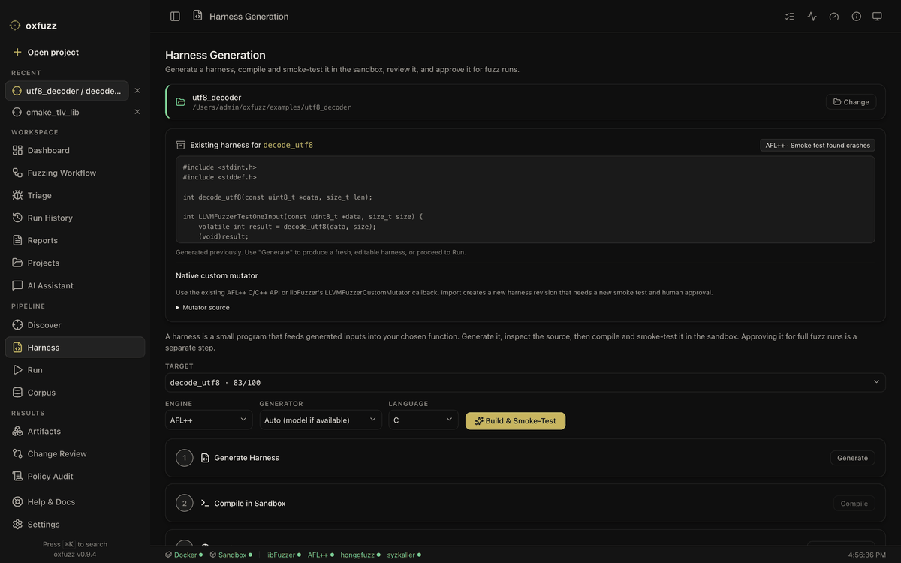
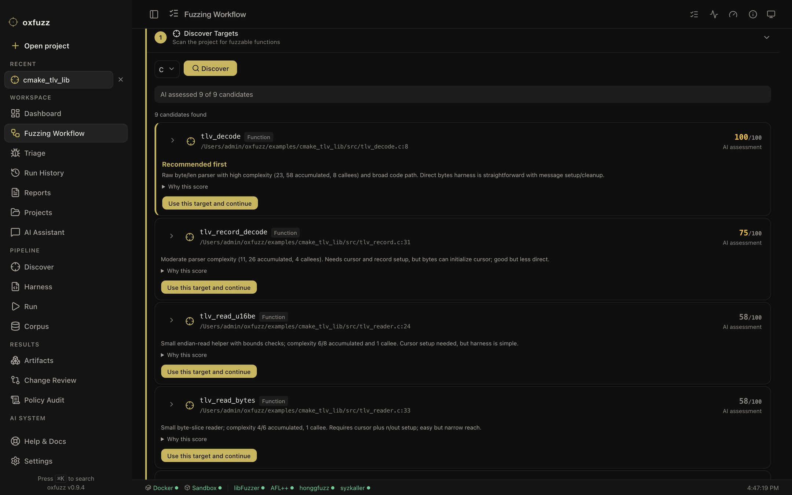
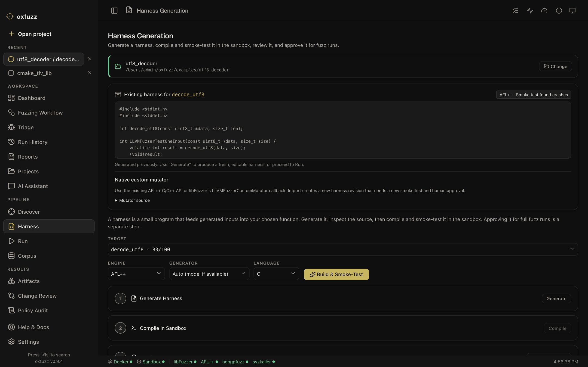
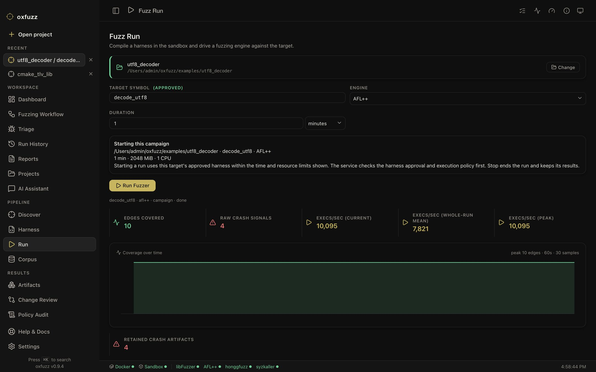
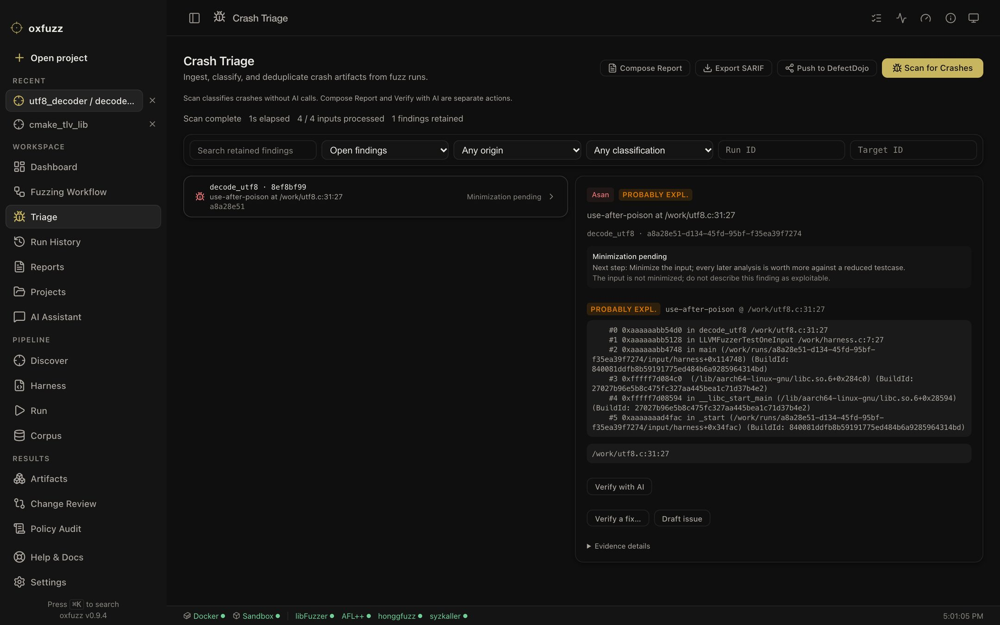

<div align="center">

<a href="https://oxfuzz.bionicloud.net"></a>

# oxfuzz

**English** &middot; [中文](README.zh.md)

### Find the crash before your users do.

The open-source AI fuzzing agent for C, C++ and Rust.

[](https://github.com/HenryCooper86/oxfuzz/releases/latest)
[](https://github.com/HenryCooper86/oxfuzz/actions/workflows/ci.yml)
[](LICENSE)
[](rust-toolchain.toml)
[](docs/guides/INSTALL.md)

[**Website**](https://oxfuzz.bionicloud.net) &middot; [**Download**](https://oxfuzz.bionicloud.net/#downloads) &middot; [**Getting Started**](docs/guides/GETTING_STARTED.md) &middot; [**Documentation**](#documentation) &middot; [**Contribute**](#contributing)

</div>

Point oxfuzz at a source folder. It picks the functions worth attacking, writes
the harness, runs AFL++, libFuzzer, honggfuzz or syzkaller in a sandbox, and
hands back every crash with the input and stack trace that reproduce it. You
approve every step. Desktop app, CLI, and REST API over one service core.

<p align="center">
  
</p>

<p align="center"><sub>A real session on the bundled <code>utf8_decoder</code> example, shortened to fit.</sub></p>

<div align="center">

| Target score | Campaign | Peak speed | Found after | Result |
| :---: | :---: | :---: | :---: | :---: |
| **83 / 100** | **1 minute, AFL++** | **10,095 runs per second** | **123 executions** | **4 crashing inputs, 1 finding** |

</div>

The finding: `use-after-poison` in `decode_utf8` at `utf8.c:31`, rated probably
exploitable. Two bytes are enough -- a lead byte that promises three sends the
decoder past the end of the buffer.

---

## Why oxfuzz

A fuzzer throws millions of unexpected inputs at your code and watches for
memory errors. The catch has always been the groundwork: choosing targets,
writing harnesses, building with sanitizers, and sorting through piles of
duplicate crashes. oxfuzz does that groundwork and leaves the decisions to you.

<table>
<tr>
<td width="33%" valign="top">

**Minutes to a first run**

Open a folder and get a ranked list of targets, with a reason for each. There
is no harness to write by hand.

</td>
<td width="33%" valign="top">

**Crashes you can prove**

Every finding keeps its input, sanitizer report and stack trace, so anyone on
your team can replay it.

</td>
<td width="33%" valign="top">

**Nothing runs unreviewed**

Generated code is built and run in a container with no network, and only after
you approve it.

</td>
</tr>
</table>

New to fuzzing? The **[Getting Started guide](docs/guides/GETTING_STARTED.md)**
explains everything from scratch, walks through a first run in the desktop app,
and includes a glossary of every term.

## From a source folder to a triaged crash in four steps

<table>
<tr>
<td width="50%" valign="top">
<a href="website/src/screenshots/discover.jpg"></a>

**1. Discover.** oxfuzz scans the project and ranks the functions most worth
fuzzing, with a score and a short reason for each.

</td>
<td width="50%" valign="top">
<a href="website/src/screenshots/harness.jpg"></a>

**2. Review the harness.** A model drafts it. It is compiled and smoke-tested
in the sandbox, then waits for you. No campaign runs until you approve it.

</td>
</tr>
<tr>
<td width="50%" valign="top">
<a href="website/src/screenshots/run.jpg"></a>

**3. Run.** Start a time-limited campaign and watch coverage, speed and crashes
live. Stop it whenever you like; the results stay.

</td>
<td width="50%" valign="top">
<a href="website/src/screenshots/triage.jpg"></a>

**4. Triage.** Crashes are replayed, grouped by stack and rated. Export a
report, SARIF, or an issue draft.

</td>
</tr>
</table>

## Four engines, one workflow

oxfuzz drives the fuzzers you already trust. You choose the engine; the steps
around it stay the same.

| Engine | Best for |
| --- | --- |
| [**libFuzzer**](https://llvm.org/docs/LibFuzzer.html) | In-process and fast. The usual first choice for a library. |
| [**AFL++**](https://aflplus.plus/) | Coverage-guided, with strong mutation and corpus tools. |
| [**honggfuzz**](https://honggfuzz.dev/) | Multi-process, with hardware and software feedback. |
| [**syzkaller**](docs/guides/SYZKALLER_SETUP.md) | Linux kernel fuzzing in a VM. You supply the kernel and guest image. |

Which languages, engines, and build systems work today is listed in the
[Support Matrix](docs/guides/SUPPORT_MATRIX.md).

## The fuzzer runs untrusted code. You stay in charge of it.

- **Sandboxed.** Every build and every run happens in a Docker container with
  no network. Nothing generated runs on your machine directly, and there is no
  host-execution fallback.
- **Approved by a person.** A harness is reviewed by a model and then by you.
  Approval is bound to the exact harness revision that may enter a campaign.
- **Your choice of model.** OpenAI, Anthropic, Gemini, Azure OpenAI, Ollama, or
  any OpenAI-compatible endpoint, with spending limits you set.

Details are in the [Safety Model](docs/guides/SAFETY_MODEL.md).

<details>
<summary><b>Everything oxfuzz does</b> (full capability table)</summary>

<br>

| Capability | Description |
| --- | --- |
| **Operational Dashboard** | Readiness, harness-review state, recent campaigns, crash handoff, and evidence counts in one operator-focused view. |
| **Target Discovery** | Semantic + static-analysis scan of a project producing a ranked Target Inventory (fit score, input surface, complexity, call-graph reachability). |
| **AI Target Recommendations** | Discover shows scan results first, then automatically ranks promising targets by bug potential, reachable code, and harness feasibility; every AI score is explained and the original scan score remains visible. |
| **Optional Semgrep Enrichment** | Explicit C/C++-only enrichment adds capped, advisory static-analysis signals from a pinned offline rules snapshot without changing normal discovery. Off by default; build with `--features semgrep-enrichment`. |
| **Harness Generation** | LLM-authored, compile-validated, smoke-fuzzed harnesses per target. |
| **Harness Qualification Evidence** | Retained AFL++ input and persistent-sequence observations appear in Harness and History; unavailable or suspect measurements remain explicit. |
| **Native Custom Mutators** | Import reviewed C/C++ source for upstream AFL++ or libFuzzer APIs, qualify a new harness revision, and retain artifact/image identity for replay. |
| **Engine Integration** | AFL++, honggfuzz, libFuzzer, and syzkaller behind one `EngineAdapter` trait. |
| **Crash Triage** | Dedup by stack signature, CASR severity/exploitability, minimize, and LLM-drafted bug reports under human review. |
| **Corpus & Coverage** | Seed, grow, prune, and merge corpora; track coverage deltas; feed crashes back into the corpus. |
| **AI Assistant** | A conversational control surface for the same service-owned workflow, with visible tool activity and policy-enforced human approval gates. |
| **Multi-Provider LLM Pool** | Tag-based routing, automatic failover, provider freeze/thaw across OpenAI, Anthropic, Gemini, and OpenAI-compatible backends. |
| **Workflow Spending Limits** | Set durable model-call, token, and USD limits in Settings; inspect usage and denials in Dashboard. Concurrent requests and retries reserve allowance before dispatch. |
| **Sandboxed Execution** | Every harness build and fuzz run goes through the mandatory Docker-backed `hf-runtime`; there is no production host-execution fallback. |
| **Scheduled Campaigns** | Headless, budget-bounded fuzzing on an interval/cron/once schedule, rotating through a project's promoted targets. |
| **Issue & Vuln Tracking** | File crashes as GitHub/GitLab issues or push them to DefectDojo as findings; export SARIF for code scanning. |
| **Retained Evidence** | Run history, policy decisions, reports, crash reproducers, corpora, coverage, and exportable project evidence remain available for review. |
| **Desktop, CLI & Web** | A desktop app for macOS, Linux, and Windows (Tauri v2 + React) with a built-in Help guide, a full CLI/TUI, and a REST + SSE API -- all over the same service core. |

Live engine and real-project effectiveness claims require separate qualification.
See [manual qualification](docs/guides/MANUAL_QUALIFICATION.md) and
[native custom mutators](docs/guides/MANAGED_MUTATORS.md) for the remaining operator checks.

</details>

---

## Install

**Desktop app.** Download the package for macOS, Linux, or Windows from
**[oxfuzz.bionicloud.net](https://oxfuzz.bionicloud.net/#downloads)** or the
[latest GitHub release](https://github.com/HenryCooper86/oxfuzz/releases/latest),
build the sandbox from the sandbox kit, add a model provider in Settings, and
open a source folder. Docker is required. This is an early release: macOS
packages are ad-hoc signed and not notarized, and Windows packages are
unsigned, so your system may warn you before installing.

**From source.** The CLI, the desktop app, and the sandbox image all build from
this repository; see [Install & Build](docs/guides/INSTALL.md).

## Quick start (CLI)

```bash
git clone https://github.com/HenryCooper86/oxfuzz.git && cd oxfuzz
cargo install --path crates/hf-cli --locked   # installs `oxfuzz` into ~/.cargo/bin
./scripts/build-sandbox.sh            # build and verify the fuzzing sandbox image
                                      # (one-time; large -- about 7 GB on disk)

oxfuzz init                           # write config files + create the database;
                                      # prints the config directory it used
export OPENAI_API_KEY=...             # the default provider in providers.toml reads
                                      # this; see Configuration for others / local models
oxfuzz doctor                         # Docker, sandbox image, and engines ready?

oxfuzz discover <project> --lang c    # ranked table of fuzz targets
oxfuzz fuzz <project> --lang c        # discover -> harness -> smoke -> promote -> campaign,
                                      # pausing only at the approval prompts
```

Prefer not to install? `cargo build --release -p hf-cli` leaves the binary at
`target/release/oxfuzz`. No model available? `oxfuzz fuzz <project> --ai off
--no-llm-review` runs the whole pipeline without one: harnesses start from a
deterministic template, and qualification relies on the lint and your own
approval instead of a model review. To point oxfuzz at your own
codebase, follow [Fuzz your own project](docs/guides/FUZZ_YOUR_PROJECT.md).
If something goes wrong, see [Troubleshooting](docs/guides/TROUBLESHOOTING.md).
The **[CLI Reference](docs/guides/CLI_REFERENCE.md)** covers every subcommand.

Docker must be installed and running. An LLM provider is needed for harness
drafting and AI ranking; without one, use the work-order flow below with
`--ai off`. Harness compilation and fuzzer launches are approval-gated high-risk actions:
on a terminal the CLI asks per action (`[y]es` once, `[n]o`, or `[a]lways` for
that action kind this session); piped or CI runs never prompt and read consent
from the environment instead (`HF_AUTO_APPROVE=1`, or `HF_GUARDRAILS=permissive`
for trusted loops); the desktop app asks in a dialog. See the
[Safety Model](docs/guides/SAFETY_MODEL.md) and
[Configuration](docs/guides/CONFIGURATION.md) for the full setup.

<details>
<summary><b>The reviewed, step-by-step flow</b> (every artifact under your explicit control)</summary>

<br>

```bash
oxfuzz discover <project> --lang c --rank
oxfuzz work-order export <project> --target <symbol> --lang c \
  --engine libfuzzer --out work-order.md
# Author harness.c from the packet, then retain the IDs printed by each command:
oxfuzz work-order import --work-order <work-order SHA-256> \
  --source harness.c --origin human
oxfuzz work-order qualify --submission <submission UUID>
# Stop here. Review the exact source, lint, independent review, and smoke evidence.
oxfuzz work-order promote --attempt <attempt UUID>
oxfuzz run <project> --target <relative-file>::<symbol> \
  --engine libfuzzer --duration 60m
oxfuzz triage <project> --target <relative-file>::<symbol>
```

Import and qualification do not approve a harness. Promotion names the retained
qualification attempt you reviewed; rerunning `oxfuzz harness` would generate a
new draft rather than approve the previous source.

</details>

<details>
<summary><b>The reviewed demo</b> (rediscover a planted bug in a bundled example)</summary>

<br>

After the quick start, use the demo to discover an example target and prepare a
harness for review:

```bash
./scripts/demo-cve-rediscovery.sh            # qualify, review, then approve an exact attempt
./scripts/demo-cve-rediscovery.sh --preflight-only   # check selected engine, policy, provider configuration
```

The default target (`examples/aflpp_persistent`) trusts a declared length byte
more than the available payload. The script generates one draft, imports its
exact source into a retained Work Order, and qualifies it through lint,
sandboxed compilation, independent review, and smoke testing. It displays the
source and qualification result before asking you to approve that attempt ID.
Approval promotes that exact attempt without generating another harness, then
starts a bounded run and triage. Declining or reaching EOF stops the workflow;
there is no `--yes` bypass.

A planted bug may already crash during smoke testing. Failed qualification stops
before promotion and retains the attempt for investigation. Preflight checks
provider configuration, not credentials or model connectivity. Completion time
and crash discovery depend on the provider, engine, harness, and corpus. Other
fixtures isolate other bug classes; see **[examples/README.md](examples/README.md)**.

</details>

---

## Documentation

New here? Start with the **[Getting Started guide](docs/guides/GETTING_STARTED.md)**
-- a plain-language intro for non-experts.

| Guides | |
| --- | --- |
| [Install & Build](docs/guides/INSTALL.md) | Prerequisites, CLI and desktop builds, prebuilt apps, and optional DefectDojo. |
| [Fuzz your own project](docs/guides/FUZZ_YOUR_PROJECT.md) | Point oxfuzz at a real C, C++, or Rust codebase: build systems, headers, and CI. |
| [Support Matrix](docs/guides/SUPPORT_MATRIX.md) | Which languages, engines, and build systems work today. |
| [Troubleshooting](docs/guides/TROUBLESHOOTING.md) | Docker, the sandbox image, providers, and build failures. |
| [The Desktop App](docs/guides/DESKTOP_APP.md) | The primary UI: a campaign end to end, the AI Assistant, and settings. |
| [CLI Reference](docs/guides/CLI_REFERENCE.md) | Every subcommand, the quick-start flow, optional Semgrep enrichment, and automotive workflows. |
| [Configuration](docs/guides/CONFIGURATION.md) | The config tree, providers, and environment. |
| [Safety Model](docs/guides/SAFETY_MODEL.md) | Sandboxing, guardrails, and human-in-the-loop approval. |

Also: [Syzkaller setup](docs/guides/SYZKALLER_SETUP.md) &middot; [Release checklist](docs/guides/RELEASE_CHECKLIST.md) &middot; [Continuous integration](docs/guides/CI.md)

**Reference**

- [Architecture](docs/ARCHITECTURE.md) -- layering, the `hf-service` spine, and the crate map.
- [Documentation map](docs/README.md) -- routes readers by audience and task.
- [Design documents](docs/design/) &middot; [Engineering standards](docs/standards/)

## Contributing

oxfuzz is open source, and you can help shape it. The whole project is here
under the MIT license: the desktop app, the service behind it, and the sandbox.
A bug report, a fixed typo, a new example target, or a feature you built for
your own team all make oxfuzz better for the next person.

- [Report a bug or ask for a feature](https://github.com/HenryCooper86/oxfuzz/issues/new/choose) -- tell us what broke or what is missing.
- [Send a pull request](CONTRIBUTING.md) -- the contributing guide covers setup, tests and style.
- [Pick up an open issue](https://github.com/HenryCooper86/oxfuzz/issues) -- see what is planned and what needs a hand.
- [Report a security problem privately](SECURITY.md) -- please do not open a public issue for these.

More: [Code of Conduct](CODE_OF_CONDUCT.md) &middot; [Getting help](SUPPORT.md) &middot; [Vision](VISION.md) &middot; [Engineering protocol](docs/standards/ENGINEERING_PROTOCOL.md)

## Acknowledgements

oxfuzz is inspired by and based on **[y-agent](https://github.com/gorgiaxx/y-agent)** by [Gorgias (gorgiaxx)](https://github.com/gorgiaxx) -- a model-agnostic Rust agent framework that turns objectives into controlled, recoverable, and observable work. Its design (agent orchestration, skills, knowledge retrieval, recovery, and multi-surface CLI/TUI/REST/desktop presentation) shaped the foundations of this project. Please visit and use his awesome project.

The optional enrichment sandbox runs
[`Semgrep CE 1.169.0`](https://github.com/semgrep/semgrep/tree/v1.169.0) as a
separate LGPL-2.1 process and bundles the MIT-licensed
[`0xdea/semgrep-rules` C/C++ snapshot](https://github.com/0xdea/semgrep-rules/tree/4d66ecf30bfb1809a984085f2c86a8c3915bfc71).
Distribution notices and exact provenance are retained in
[`third_party/semgrep`](third_party/semgrep) and
[`third_party/semgrep-rules`](third_party/semgrep-rules).

## License

[MIT](LICENSE)
