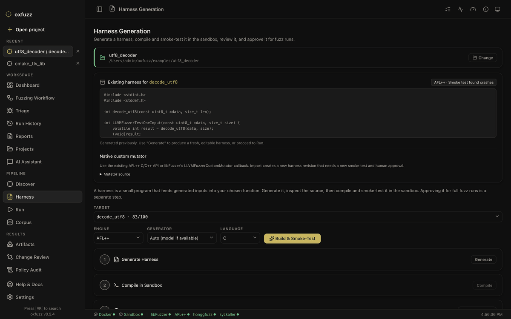
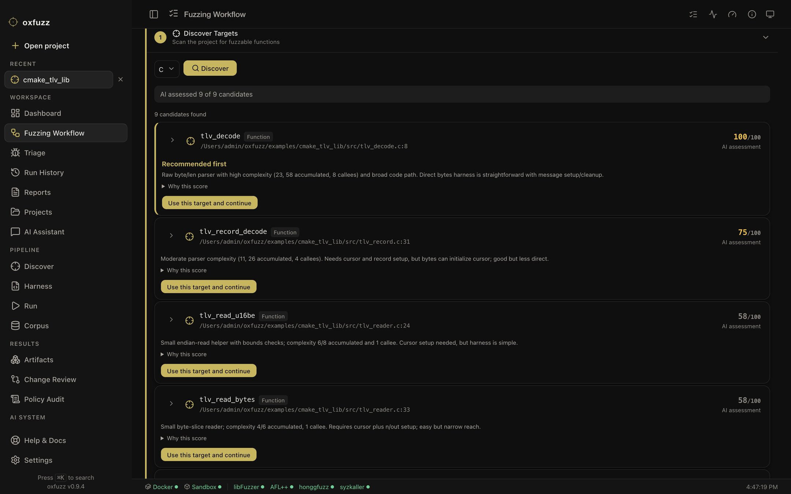
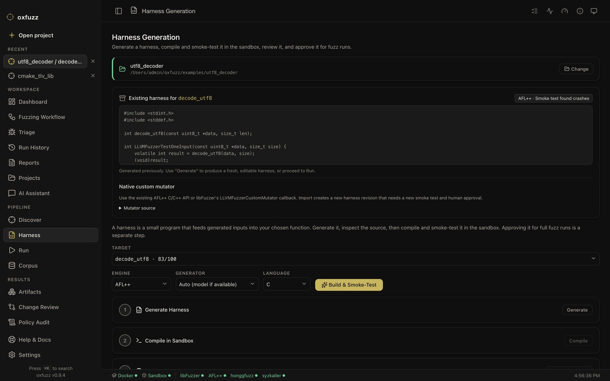
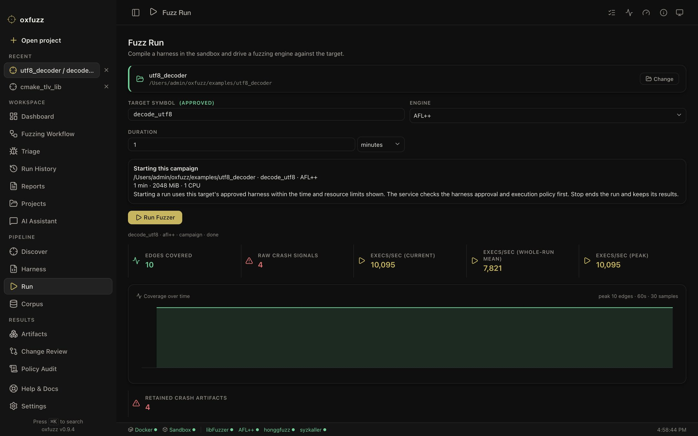
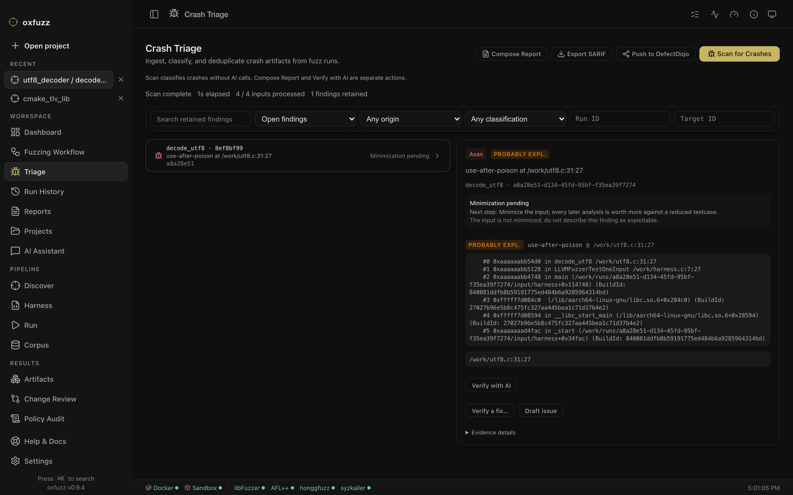

<div align="center">

<a href="https://oxfuzz.bionicloud.net/zh/"></a>

# oxfuzz

[English](README.md) &middot; **中文**

### 抢在用户之前，找到那个崩溃。

面向 C、C++ 和 Rust 的开源 AI 模糊测试智能体。

[](https://github.com/HenryCooper86/oxfuzz/releases/latest)
[](https://github.com/HenryCooper86/oxfuzz/actions/workflows/ci.yml)
[](LICENSE)
[](rust-toolchain.toml)
[](docs/guides/INSTALL.md)

[**官网**](https://oxfuzz.bionicloud.net) &middot; [**下载**](https://oxfuzz.bionicloud.net/#downloads) &middot; [**入门指南**](docs/guides/GETTING_STARTED.md) &middot; [**文档**](#documentation) &middot; [**参与贡献**](#contributing)

</div>

给 oxfuzz 一个源码目录，它会挑出最值得攻击的函数，写好测试桩，在沙箱里运行
AFL++、libFuzzer、honggfuzz 或 syzkaller，并把每个崩溃连同可复现的输入和调用栈
一起交给你。每一步都由你批准。桌面应用、命令行和 REST API 共用同一套服务核心。

<p align="center">
  
</p>

<p align="center"><sub>内置示例 <code>utf8_decoder</code> 上的一次真实运行，为便于展示做了缩短。</sub></p>

<div align="center">

| 目标评分 | 测试时长 | 峰值速度 | 发现于 | 结果 |
| :---: | :---: | :---: | :---: | :---: |
| **83 / 100** | **1 分钟，AFL++** | **每秒 10,095 次执行** | **第 123 次执行** | **4 个崩溃输入，1 个发现** |

</div>

这个发现是：`decode_utf8` 在 `utf8.c:31` 处的 `use-after-poison`，评级为很可能可利用。
只需两个字节 —— 首字节声称后面有三个字节，解码器就会读到缓冲区之外。

---

## 为什么选择 oxfuzz

模糊测试器向你的代码投入数以百万计的异常输入，并盯住内存错误。真正费事的一直是
前期工作：选目标、写测试桩、带着 sanitizer 编译，再从一大堆重复的崩溃里理出头绪。
oxfuzz 替你做完这些，把决定权留给你。

<table>
<tr>
<td width="33%" valign="top">

**几分钟内开始第一次运行**

打开一个目录，就能得到排好序的目标列表，每个都附有理由。不用手写测试桩。

</td>
<td width="33%" valign="top">

**拿得出证据的崩溃**

每个发现都保留输入、sanitizer 报告和调用栈，团队里任何人都能重放。

</td>
<td width="33%" valign="top">

**未经审查的代码不会运行**

生成的代码只在没有网络的容器里编译和运行，而且要先经过你的批准。

</td>
</tr>
</table>

模糊测试新手？**[入门指南](docs/guides/GETTING_STARTED.md)** 从零开始解释一切，
带你在桌面应用里走完第一次运行，并附有每个术语的词汇表。

## 从源码目录到分类完毕的崩溃，只需四步

<table>
<tr>
<td width="50%" valign="top">
<a href="website/src/screenshots/discover.jpg"></a>

**1. 发现目标。** oxfuzz 扫描整个项目，给最值得测试的函数排序，并为每个函数给出评分和简短理由。

</td>
<td width="50%" valign="top">
<a href="website/src/screenshots/harness.jpg"></a>

**2. 审查测试桩。** 模型先起草，随后在沙箱里编译并做冒烟测试，然后等你确认。在你批准之前，不会启动任何测试。

</td>
</tr>
<tr>
<td width="50%" valign="top">
<a href="website/src/screenshots/run.jpg"></a>

**3. 运行。** 启动一次限时测试，实时查看覆盖率、速度和崩溃。可以随时停止，结果会保留。

</td>
<td width="50%" valign="top">
<a href="website/src/screenshots/triage.jpg"></a>

**4. 崩溃分类。** 崩溃会被重放、按调用栈归并并评级。可以导出报告、SARIF 或 issue 草稿。

</td>
</tr>
</table>

## 四个引擎，一套流程

oxfuzz 驱动的是你早已信任的模糊测试器。引擎由你选择，其余步骤保持不变。

| 引擎 | 适用场景 |
| --- | --- |
| [**libFuzzer**](https://llvm.org/docs/LibFuzzer.html) | 进程内运行，速度快。测试库代码时通常首选它。 |
| [**AFL++**](https://aflplus.plus/) | 覆盖率引导，变异能力和语料工具都很强。 |
| [**honggfuzz**](https://honggfuzz.dev/) | 多进程，支持硬件和软件反馈。 |
| [**syzkaller**](docs/guides/SYZKALLER_SETUP.md) | 在虚拟机中对 Linux 内核做模糊测试。内核和客户机镜像由你提供。 |

目前支持哪些语言、引擎与构建系统，见[支持矩阵](docs/guides/SUPPORT_MATRIX.md)。

## 模糊测试运行的是不可信代码，控制权始终在你手里。

- **沙箱隔离。** 每次编译、每次运行都在没有网络的 Docker 容器中进行。生成的代码不会
  直接在你的机器上运行，也不存在主机执行回退。
- **由人批准。** 测试桩先由模型审查，再由你审查。人工审批被绑定到被允许进入测试的
  那一个确切的测试桩修订版。
- **模型由你选择。** 可使用 OpenAI、Anthropic、Gemini、Azure OpenAI、Ollama，或任何
  兼容 OpenAI 的接口，并自行设定花费上限。

详见[安全模型](docs/guides/SAFETY_MODEL.md)。

<details>
<summary><b>oxfuzz 的全部能力</b>（完整能力表）</summary>

<br>

| 能力 | 说明 |
| --- | --- |
| **运营仪表盘** | 在一个面向操作员的视图中集中呈现就绪度、测试桩审核状态、近期 campaign、崩溃移交与证据计数。 |
| **目标发现** | 对项目进行语义 + 静态分析扫描，产出排名后的目标清单（契合度评分、输入面、复杂度、调用图可达性）。 |
| **AI 目标推荐** | “发现”先显示扫描结果，再根据发现缺陷的潜力、可达代码和测试入口可实现性自动排序；AI 分数附有说明，原始扫描分数仍可查看。 |
| **可选 Semgrep 增强** | 显式的、仅限 C/C++ 的增强，从固定的离线规则快照中加入有上限的、仅供参考的静态分析信号，且不改变常规发现流程。默认关闭；使用 `--features semgrep-enrichment` 构建即可启用。 |
| **测试桩生成** | 由 LLM 编写、经编译校验、经冒烟模糊的按目标测试桩。 |
| **测试桩资格验证证据** | 在测试桩和历史视图中查看保留的 AFL++ 输入与持久模式下的序列观测；不可用或存疑的测量均明确标示。 |
| **原生自定义变异器** | 导入经审核的 C/C++ 源码，使用上游 AFL++ 或 libFuzzer API，验证新的测试桩修订版，并为重放保留产物与镜像标识。 |
| **引擎集成** | AFL++、honggfuzz、libFuzzer 和 syzkaller，统一收敛到一个 `EngineAdapter` trait 之后。 |
| **崩溃三查** | 按栈签名去重、以 CASR 判定严重度/可利用性、最小化，以及在人工审核下由 LLM 起草的缺陷报告。 |
| **语料库与覆盖率** | 播种、扩展、修剪与合并语料库；跟踪覆盖率增量；把崩溃回喂到语料库。 |
| **AI 助手** | 面向同一套服务托管工作流的对话式控制界面，工具活动可见，并有策略强制的人工审批门。 |
| **多提供方 LLM 池** | 基于标签的路由、自动故障转移，以及跨 OpenAI、Anthropic、Gemini 及 OpenAI 兼容后端的提供方冻结/解冻。 |
| **工作流费用限额** | 在设置中配置持久化的模型请求、token 与美元限额，在仪表盘查看用量和拒绝记录。并发请求与重试均在发送前预留额度。 |
| **沙箱化执行** | 每一次测试桩构建与模糊运行都经过强制的、以 Docker 为后盾的 `hf-runtime`；不存在生产环境的主机执行回退。 |
| **计划化 campaign** | 无头、预算受限的模糊测试，按间隔/cron/一次性计划运行，在项目已提升的目标间轮换。 |
| **问题与漏洞跟踪** | 将崩溃作为 GitHub/GitLab issue 提交，或作为 finding 推送到 DefectDojo；导出 SARIF 供代码扫描。 |
| **保留的证据** | 运行历史、策略决策、报告、崩溃复现器、语料库、覆盖率与可导出的项目证据均保留可审。 |
| **桌面、CLI 与 Web** | 适用于 macOS、Linux 与 Windows 的桌面应用（Tauri v2 + React），内置帮助指南；完整的 CLI/TUI；以及 REST + SSE API —— 全部构建在同一套服务核心之上。 |

真实引擎运行和真实项目效果的结论需要单独验证。
参见[手动资格验证](docs/guides/MANUAL_QUALIFICATION.md)和
[原生自定义变异器](docs/guides/MANAGED_MUTATORS.md)，了解尚需操作员完成的检查。

</details>

---

## 安装

**桌面应用。** 从 **[oxfuzz.bionicloud.net](https://oxfuzz.bionicloud.net/#downloads)**
或[最新的 GitHub release](https://github.com/HenryCooper86/oxfuzz/releases/latest)
下载适用于 macOS、Linux 或 Windows 的安装包，用沙箱套件构建沙箱，在“设置”中添加模型服务，
然后打开一个源码目录。需要 Docker。这是早期版本：macOS 安装包为临时签名且未经公证，
Windows 安装包未签名，安装前系统可能会给出警告。

**从源码构建。** 命令行、桌面应用和沙箱镜像都可以从本仓库构建；见[安装与构建](docs/guides/INSTALL.md)。

## 快速开始（命令行）

```bash
git clone https://github.com/HenryCooper86/oxfuzz.git && cd oxfuzz
cargo install --path crates/hf-cli --locked   # 将 `oxfuzz` 安装到 ~/.cargo/bin
./scripts/build-sandbox.sh            # 构建并验证模糊测试沙箱镜像
                                      # （一次性；体积较大，约占 7 GB 磁盘）

oxfuzz init                           # 写入配置文件并创建数据库；
                                      # 会打印实际使用的配置目录
export OPENAI_API_KEY=...             # providers.toml 中的默认提供方读取该变量；
                                      # 其他提供方与本地模型见“配置”文档
oxfuzz doctor                         # Docker、沙箱镜像与引擎是否就绪？

oxfuzz discover <project> --lang c    # 以表格列出排序后的模糊测试目标
oxfuzz fuzz <project> --lang c        # 发现 -> harness -> smoke -> 提升 -> campaign，
                                      # 只在审批提示处暂停
```

不想安装？`cargo build --release -p hf-cli` 会把二进制留在
`target/release/oxfuzz`。没有可用模型？`oxfuzz fuzz <project> --ai off
--no-llm-review` 可在不调用模型的情况下跑完整条流水线：harness 从确定性
模板起步，资格验证依靠 lint 检查与你本人的审批，而不是模型评审。
要对你自己的代码库进行模糊测试，请参阅[对你自己的项目做模糊测试](docs/guides/FUZZ_YOUR_PROJECT.md)。
遇到问题请查看[故障排查](docs/guides/TROUBLESHOOTING.md)。
**[CLI 参考](docs/guides/CLI_REFERENCE.md)** 覆盖每一个子命令。

Docker 必须已安装并正在运行。harness 起草与 AI 排序需要 LLM 提供方；没有提供方时，
请使用下面的 work-order 流程并加上 `--ai off`。harness 编译与
模糊测试启动属于需要审批的高风险操作：在终端中 CLI 会按操作逐项询问
（`[y]es` 仅此一次、`[n]o` 拒绝、`[a]lways` 本次会话内允许该类操作）；
管道或 CI 等非终端环境不会提示，而是从环境变量读取授权
（`HF_AUTO_APPROVE=1`，可信本地循环可用 `HF_GUARDRAILS=permissive`），
桌面应用则通过对话框询问。参见
[安全模型](docs/guides/SAFETY_MODEL.md)与
[配置](docs/guides/CONFIGURATION.md)了解完整搭建。

<details>
<summary><b>带人工评审的逐步流程</b>（每个产物都处于你的显式控制之下）</summary>

<br>

```bash
oxfuzz discover <project> --lang c --rank
oxfuzz work-order export <project> --target <symbol> --lang c \
  --engine libfuzzer --out work-order.md
# Author harness.c from the packet, then retain the IDs printed by each command:
oxfuzz work-order import --work-order <work-order SHA-256> \
  --source harness.c --origin human
oxfuzz work-order qualify --submission <submission UUID>
# Stop here. Review the exact source, lint, independent review, and smoke evidence.
oxfuzz work-order promote --attempt <attempt UUID>
oxfuzz run <project> --target <relative-file>::<symbol> \
  --engine libfuzzer --duration 60m
oxfuzz triage <project> --target <relative-file>::<symbol>
```

导入与资格验证并不等于批准 harness。提升操作指定的是你评审过的那一次保留的资格验证尝试；
重新运行 `oxfuzz harness` 会生成新的草稿，而不是批准之前的源码。

</details>

<details>
<summary><b>带人工评审的演示</b>（在内置示例中重新发现一个植入的缺陷）</summary>

<br>

完成快速开始后，使用演示脚本发现示例目标并准备待评审的 harness：

```bash
./scripts/demo-cve-rediscovery.sh            # 资格验证、评审，然后批准指定的尝试
./scripts/demo-cve-rediscovery.sh --preflight-only   # 检查所选引擎、策略和提供方配置
```

默认目标（`examples/aflpp_persistent`）信任声明的长度字节而非实际可用的载荷。
脚本只生成一个草稿，将其原始源码导入持久保存的 Work Order，再进行 lint、沙箱编译、
独立评审和冒烟测试。脚本显示源码和资格验证结果，然后请你批准该尝试 ID。
批准后只晋升该尝试，不会重新生成 harness，随后启动有界运行和缺陷分诊。
拒绝或遇到 EOF 都会停止流程；不提供 `--yes` 跳过确认的选项。

植入的缺陷可能在冒烟测试期间就触发崩溃。资格验证失败会在晋升前停止，并保留尝试供调查。
预检检查提供方配置，不验证凭据或模型连通性。完成时间和缺陷发现取决于提供方、引擎、
harness 和语料库。其他示例分别覆盖其他缺陷类别；见 **[examples/README.md](examples/README.md)**。

</details>

---

<a id="documentation"></a>

## 文档

新手请从 **[入门指南](docs/guides/GETTING_STARTED.md)** 开始 —— 面向非专家的大白话介绍。

> 说明：详细的参考文档目前为英文。

| 指南 | |
| --- | --- |
| [安装与构建](docs/guides/INSTALL.md) | 先决条件、CLI 与桌面构建、预构建应用，以及可选的 DefectDojo。 |
| [对你自己的项目做模糊测试](docs/guides/FUZZ_YOUR_PROJECT.md) | 将 oxfuzz 用于真实的 C、C++ 或 Rust 代码库：构建系统、头文件与 CI。 |
| [支持矩阵](docs/guides/SUPPORT_MATRIX.md) | 目前支持哪些语言、引擎与构建系统。 |
| [故障排查](docs/guides/TROUBLESHOOTING.md) | Docker、沙箱镜像、模型提供方与构建失败。 |
| [桌面应用](docs/guides/DESKTOP_APP.md) | 主界面：一次完整的 campaign、AI 助手与设置。 |
| [CLI 参考](docs/guides/CLI_REFERENCE.md) | 每个子命令、快速开始流程、可选 Semgrep 增强与汽车协议工作流。 |
| [配置](docs/guides/CONFIGURATION.md) | 配置树、提供方与环境。 |
| [安全模型](docs/guides/SAFETY_MODEL.md) | 沙箱、护栏与人工闭环审批。 |

另见：[Syzkaller 搭建](docs/guides/SYZKALLER_SETUP.md) &middot; [发布检查清单](docs/guides/RELEASE_CHECKLIST.md) &middot; [持续集成](docs/guides/CI.md)

**参考**

- [架构](docs/ARCHITECTURE.md) —— 分层、`hf-service` 主干与 crate 映射。
- [文档地图](docs/README.md) —— 按受众与任务为读者导航。
- [设计文档](docs/design/) &middot; [工程标准](docs/standards/)

<a id="contributing"></a>

## 参与贡献

oxfuzz 是开源项目，欢迎你一起把它做得更好。整个项目都在这里，采用 MIT 许可：桌面应用、
背后的服务以及沙箱。一份缺陷报告、一处错别字修正、一个新的示例目标，或者你为自己团队做的
功能，都会让下一位使用者受益。

- [告诉我们你的第一次运行情况](https://github.com/HenryCooper86/oxfuzz/discussions/34) —— 0.9.6 反馈讨论帖；简短的反馈同样欢迎。
- [报告缺陷或提出功能建议](https://github.com/HenryCooper86/oxfuzz/issues/new/choose) —— 告诉我们哪里出了问题，或者还缺什么。
- [提交 Pull Request](CONTRIBUTING.md) —— 贡献指南介绍了环境搭建、测试和代码风格。
- [认领一个未解决的 issue](https://github.com/HenryCooper86/oxfuzz/issues) —— 看看有哪些计划，哪些地方需要帮手。
- [私下报告安全问题](SECURITY.md) —— 这类问题请不要公开提交 issue。

更多：[行为准则](CODE_OF_CONDUCT.md) &middot; [获取帮助](SUPPORT.md) &middot; [愿景](VISION.md) &middot; [工程协议](docs/standards/ENGINEERING_PROTOCOL.md)

## 致谢

oxfuzz 受到 [Gorgias (gorgiaxx)](https://github.com/gorgiaxx) 的 **[y-agent](https://github.com/gorgiaxx/y-agent)** 的启发并以之为基础 —— 这是一个模型无关的 Rust 代理框架，能把目标转化为受控、可恢复、可观测的工作。它的设计（代理编排、技能、知识检索、恢复，以及 CLI/TUI/REST/桌面多界面呈现）塑造了本项目的根基。欢迎访问并使用他这个出色的项目。

可选的增强沙箱把
[`Semgrep CE 1.169.0`](https://github.com/semgrep/semgrep/tree/v1.169.0)
作为一个独立的 LGPL-2.1 进程运行，并捆绑 MIT 许可的
[`0xdea/semgrep-rules` C/C++ 快照](https://github.com/0xdea/semgrep-rules/tree/4d66ecf30bfb1809a984085f2c86a8c3915bfc71)。
分发声明与确切来源保留在
[`third_party/semgrep`](third_party/semgrep) 与
[`third_party/semgrep-rules`](third_party/semgrep-rules)。

## 许可证

[MIT](LICENSE)
